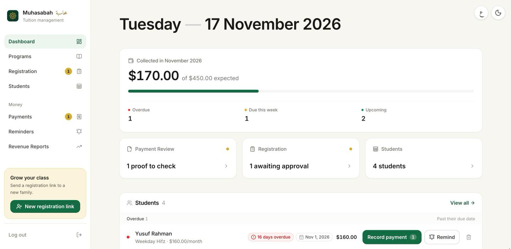
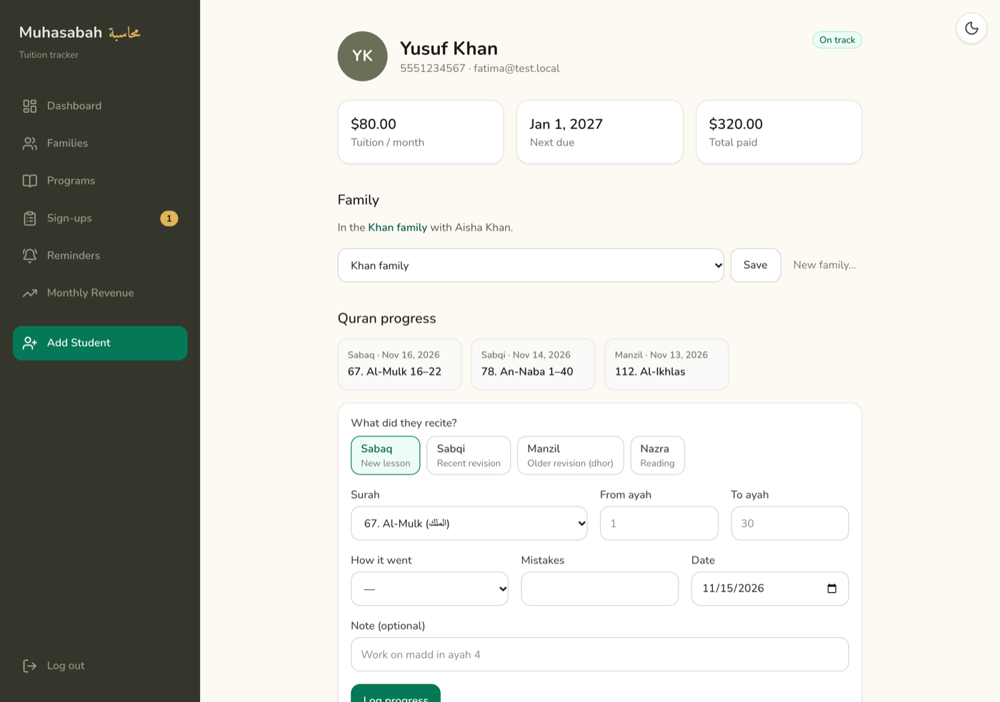
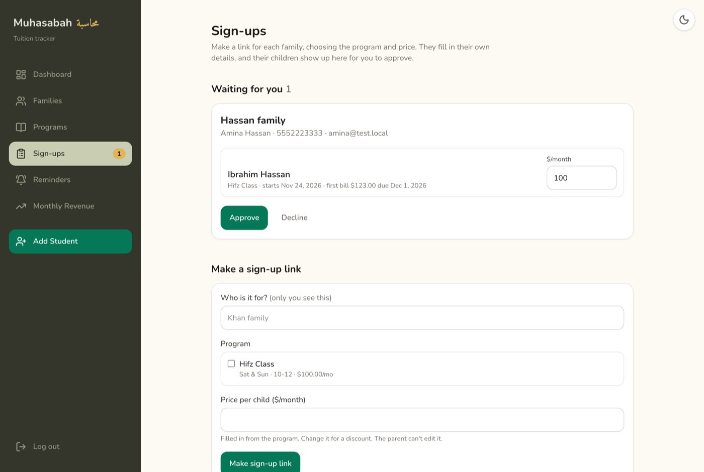
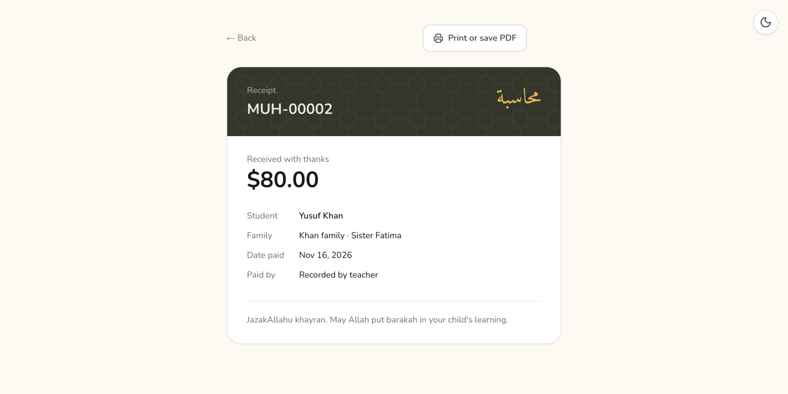
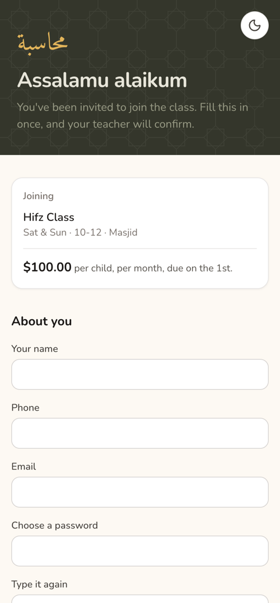
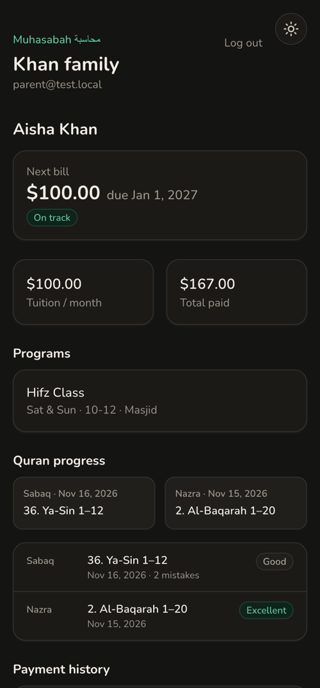

# Muhasabah · محاسبة

**A tuition tracker for teachers of Islamic classes.** It covers who's enrolled, who's paid, what's due on the 1st, and how each student's Quran memorization is going. Parents get their own portal.

**[Live app →](https://muhsabah.netlify.app)** · React Router 7 · TypeScript · PostgreSQL · Prisma · Tailwind CSS · Netlify



*Muhasabah* (محاسبة) means "taking account": reflecting on where things stand. Here, it's your class.

## Why I built it

Small Quran and Islamic-studies classes usually run on a notebook and memory. Who paid this month, who joined mid-month and owes a partial bill, which sibling belongs to which family, and where each child stopped in their hifz. Muhasabah puts all of that in one calm place. It's built for one teacher, not a whole school, so there's nothing extra to set up.

## Features

| | |
|---|---|
| **Billing on the 1st** | Everyone is billed on the 1st. Join on Nov 11 at $100/month and the first bill is $167 on Dec 1: 20 prorated days plus December. |
| **Self sign-up with approval** | The teacher sends a one-time link. Someone signs up themselves, or a parent signs up one or more children, picking a program and how many days a week (e.g. 1–4 days of a Mon–Thu class). The price adjusts from the teacher's full price, and the teacher approves or declines. |
| **Payment proofs** | Families pay the teacher directly (Zelle, cash, etc.) and upload a screenshot from their portal. The teacher checks it, then confirms it (which records the payment and moves the due date) or marks it not accepted with a reason. The app never handles money. |
| **Reminders** | One tap opens WhatsApp, a text or an email with a polite message already written. Optional automatic emails go out before and after the 1st. |
| **Receipts** | Every payment gets a numbered receipt (MUH-00001) to print, save as a PDF or email. |
| **Quran progress** | Log sabaq, sabqi, manzil and nazra by surah and ayah, with mistakes and how it went. Parents see it too. |
| **Revenue** | Expected vs. collected for each month, down to each payment. |
| **English and Arabic** | A switch next to the theme toggle flips every page into Arabic, laid out right to left, with Arabic dates and surah names. |
| **Dark mode** | On every page, including sign-in, with Gregorian and Hijri dates. |

## Screenshots

<table>
  <tr>
    <td width="50%"><br><sub>Logging Quran progress</sub></td>
    <td width="50%"><br><sub>Approving sign-ups and making links</sub></td>
  </tr>
  <tr>
    <td width="50%"><br><sub>Sign-in</sub></td>
    <td width="50%"><br><sub>Printable receipt</sub></td>
  </tr>
</table>

<p>
  
  &nbsp;&nbsp;
  
</p>
<sub>The parent's side on a phone: signing up from a link, then the family portal in dark mode.</sub>

*All names in the screenshots are made-up test data.*

## How it's built

- **React Router 7 (framework mode)** on Vite, with server loaders and actions. Forms work through plain `<form>` posts with an `intent`, and every teacher route checks the session on the server.
- **PostgreSQL (Neon) + Prisma 7**, using the `pg` driver adapter. Migrations live in `prisma/migrations`.
- **Auth:** bcrypt password hashes and a signed, HTTP-only JWT cookie. Teacher and parent roles. Parents can only reach their own children (`src/lib/access.server.ts`).
- **Billing logic** in `src/lib/dates.ts`: due dates on the 1st and prorated first bills.
- **Netlify:** SSR through `@netlify/vite-plugin-react-router`, plus a scheduled function (`netlify/functions/send-reminders.mts`) for the daily reminder run.
- **Payment proofs:** screenshots are shrunk in the browser to about 1600px before upload and stored in Postgres; only the teacher and that family can open them (`src/routes/proof-image.ts`).
- **Tailwind CSS 4**, with a warm olive, gold and emerald palette, Nunito and Amiri fonts, and an eight-point-star pattern.

## Run it locally

```bash
cp .env.example .env        # fill in DATABASE_URL, SESSION_SECRET, APP_URL
npm install
npx prisma migrate deploy
npx tsx scripts/create-teacher.ts
npm run dev                  # http://localhost:5173
```

`scripts/reset-password.ts` resets a forgotten password. Check your work with `npm run typecheck`, `npm run lint` and `npm run build`.

### Optional setup

- **Email** (invites, reminders, receipts): set `RESEND_API_KEY`. To email parents, verify a domain in Resend and set `EMAIL_FROM`.
