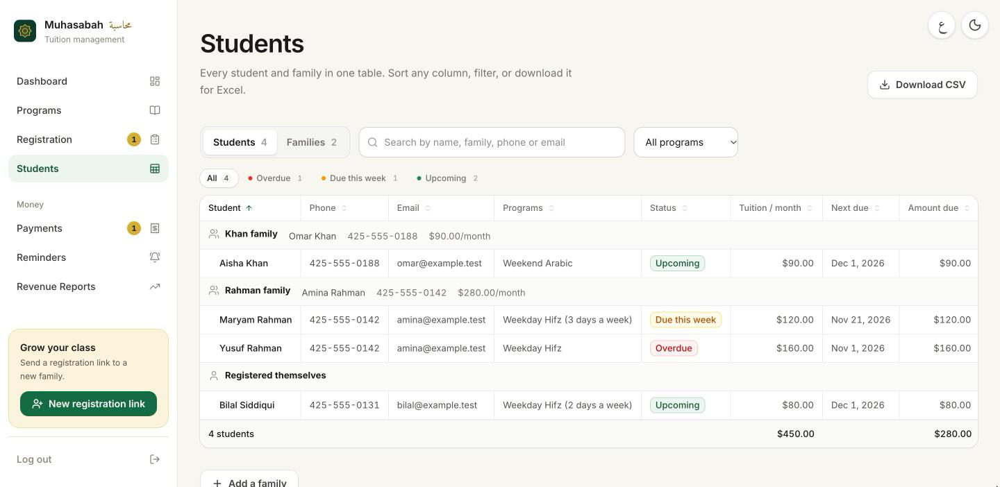
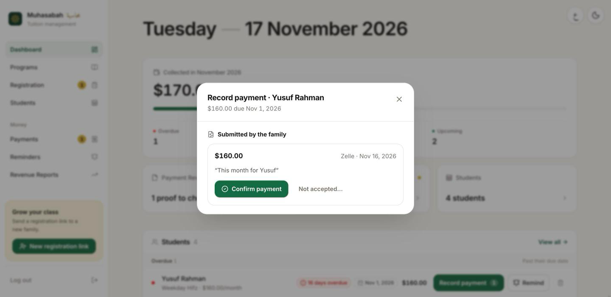
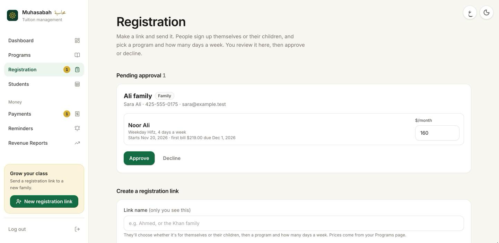
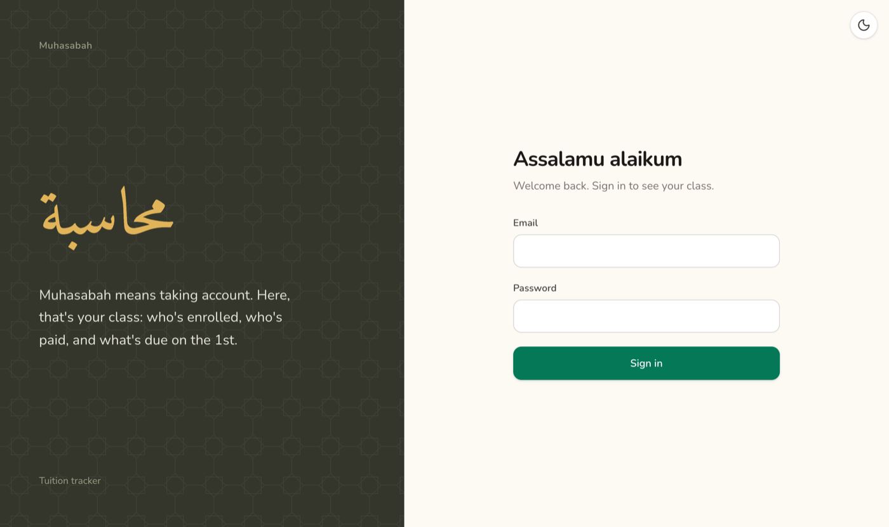
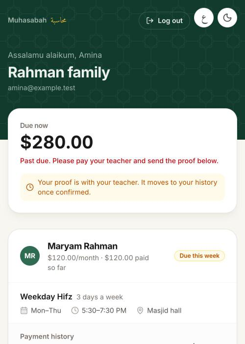

# Muhasabah · محاسبة

**Tuition management for teachers of Islamic classes.** It covers who's enrolled, who's paid, what's due on the 1st, and what each student owes. Parents get their own portal.

**[Live app →](https://muhsabah.netlify.app)** · React Router 7 · TypeScript · PostgreSQL · Prisma · Tailwind CSS · Netlify


*Muhasabah* (محاسبة) means "taking account": reflecting on where things stand. Here, it's your class.

## Why I built it

Small Quran and Islamic-studies classes usually run on a notebook and memory. Who paid this month, who joined mid-month and owes a partial bill, and which children belong to which parent. Muhasabah puts all of that in one calm place. It's built for one teacher, not a whole school, so there's nothing extra to set up.

## Features

| | |
|---|---|
| **Dashboard** | Today's date up top, then what's been collected this month against what's expected, what needs reviewing, and every student with their status (Overdue, Due this week, Upcoming). |
| **Monthly billing** | Everyone is billed on the 1st. Join on Nov 11 at $100/month and the first bill is $167 on Dec 1: 20 prorated days plus December. |
| **Programs** | Each class with its days, time, place and monthly price. Students can pick fewer days a week (e.g. 2 of a Mon–Thu class) at a prorated price. Programs can be edited any time; enrolled students keep their tuition. |
| **Registration with approval** | The teacher sends a one-time link. A parent registers one or more children (all linked to that parent's login), or an adult registers themselves (an individual student). The teacher approves or declines. |
| **Students** | A spreadsheet-style table of every student, with each student's parent and contact details. Sort any column, search, filter by status or program, see the month's payments on a calendar, and download a CSV for Excel. |
| **Payment review** | The app never handles money. Parents and students pay the teacher directly and submit every payment, cash included, from their portal (with a screenshot for transfers). The teacher confirms it, which records it and moves the due date, or marks it not accepted with a reason. |
| **Payment reminders** | One tap opens WhatsApp, a text or an email with a polite message already written. Optional automatic emails go out before and after the 1st. |
| **Receipts** | Every payment gets a numbered receipt (MUH-00001) to print, save as a PDF or email. |
| **Revenue reports** | Expected vs. collected for each month, down to each payment. |
| **Parent portal** | What's due and when, each child's class times, payment history with receipts, and the form to submit a payment. |
| **Bilingual interface** | A switch next to the theme toggle flips every page into Arabic, laid out right to left. |
| **Dark mode** | On every page, including sign-in. |

## Screenshots

<table>
  <tr>
    <td width="50%"><br><sub>Students, with filters and totals</sub></td>
    <td width="50%"><br><sub>Reviewing a submitted payment</sub></td>
  </tr>
  <tr>
    <td width="50%"><br><sub>Approving a registration</sub></td>
    <td width="50%"><br><sub>Sign-in</sub></td>
  </tr>
</table>

<p>
  
</p>
<sub>The parent portal on a phone.</sub>

*All names in the screenshots are made-up test data.*

## How it's built

- **React Router 7 (framework mode)** on Vite, with server loaders and actions. Forms work through plain `<form>` posts with an `intent`, and every teacher route checks the session on the server.
- **PostgreSQL (Neon) + Prisma 7**, using the `pg` driver adapter. Migrations live in `prisma/migrations`.
- **Auth:** bcrypt password hashes or Google sign-in (OAuth with a signed state cookie), and a signed, HTTP-only JWT session cookie. Teacher and parent roles. Parents can only reach their own children (`src/lib/access.server.ts`).
- **Billing logic** in `src/lib/dates.ts`: due dates on the 1st and prorated first bills.
- **Payments:** only the parent or student can submit a payment; the teacher reviews it (`src/lib/proofs.server.ts`). Screenshots are shrunk in the browser to about 1600px before upload and stored in Postgres; only the teacher and that parent or student can open them (`src/routes/proof-image.ts`).
- **Netlify:** SSR through `@netlify/vite-plugin-react-router`, plus a scheduled function (`netlify/functions/send-reminders.mts`) for the daily reminder run.
- **Design:** Tailwind CSS 4 with a Madinah green and gold palette on warm ivory, Inter for the interface, Tajawal and Amiri for Arabic, and an eight-point-star ornament.

## Run it locally

```bash
cp .env.example .env        # fill in DATABASE_URL, SESSION_SECRET, APP_URL
npm install
npx prisma migrate deploy
npx tsx scripts/create-teacher.ts
npm run dev                  # http://localhost:5173
```

`scripts/reset-password.ts` resets a forgotten password. Check your work with `npm run typecheck`, `npm run lint` and `npm run build`.

### Optional setup

- **Email** (invites, reminders, receipts): set `RESEND_API_KEY`. To email parents, verify a domain in Resend and set `EMAIL_FROM`.
- **Continue with Google**: create an OAuth client (Web application) in Google Cloud, add `https://<your-site>/auth/google/callback` (and the localhost one) as redirect URIs, and set `GOOGLE_CLIENT_ID` and `GOOGLE_CLIENT_SECRET`. Google never creates accounts on its own: on the sign-in page it only finds existing accounts, and new people still need a teacher's registration or invite link. Without these variables the Google buttons stay hidden.
